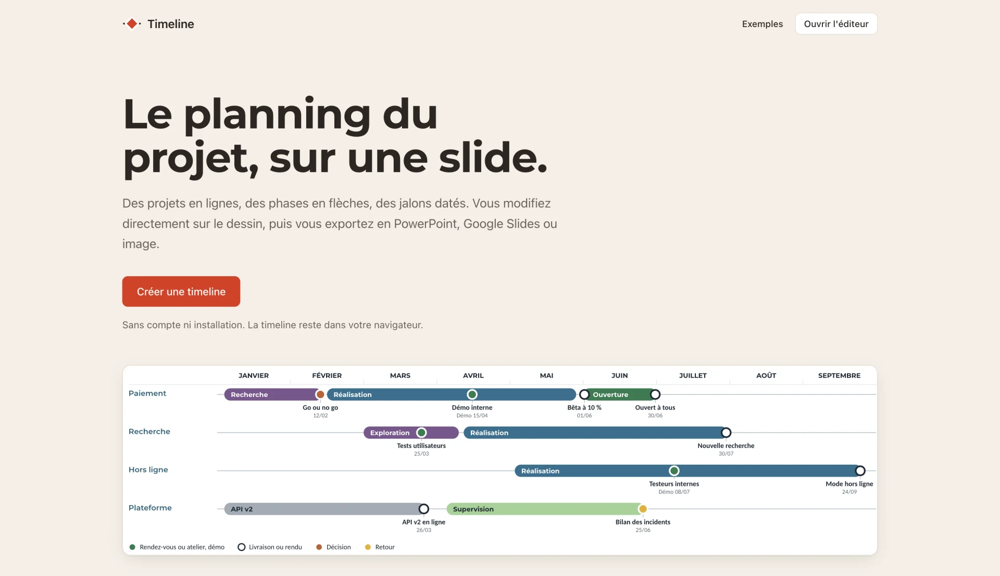
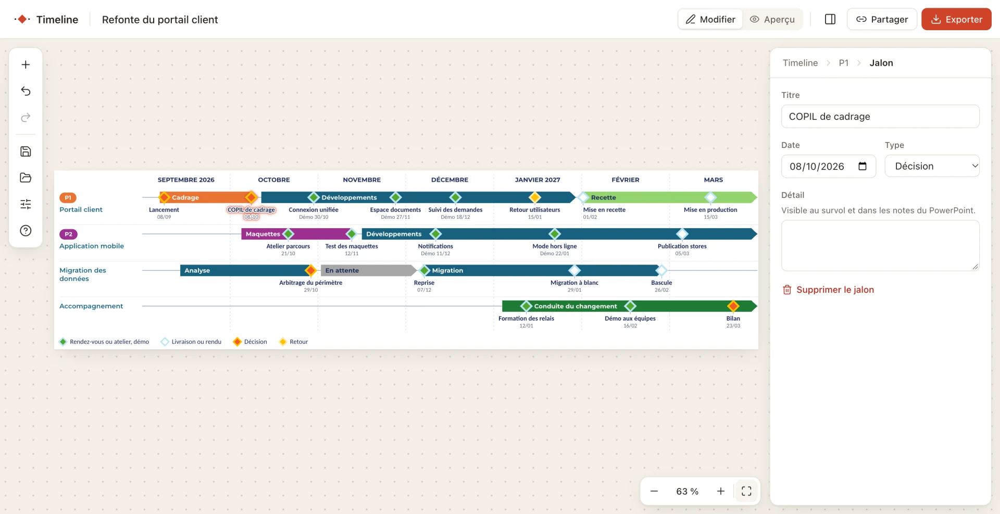
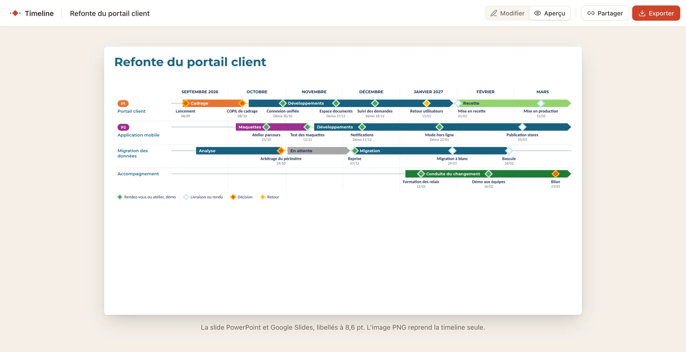
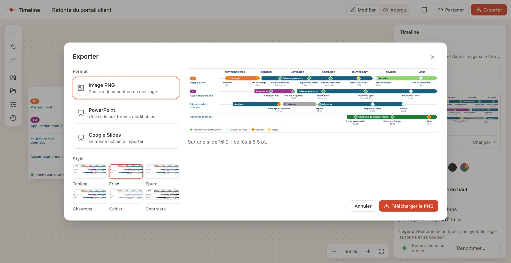
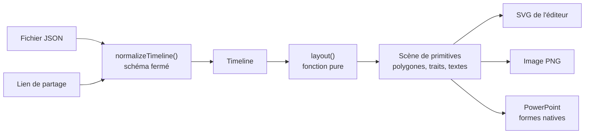

<div align="center">


# Timeline

**Le planning du projet, sur une slide.**

Des projets en lignes, des phases en flèches, des jalons datés.<br>
Modifiez directement sur le dessin, exportez en PowerPoint, Google Slides ou PNG.<br>
Sans compte, sans installation, et sans serveur qui voie vos données.

[](https://timeline.c-sanchez.fr)
[](LICENSE)
[](#vos-données-restent-chez-vous)
<br>
[](https://nuxt.com)
[](https://vuejs.org)
[](https://tailwindcss.com)
[](https://www.typescriptlang.org)

[**Ouvrir l'application**](https://timeline.c-sanchez.fr) · [Voir les exemples](https://timeline.c-sanchez.fr/#exemples) · [Lancer en local](#lancer-en-local)

<br>



</div>

## Ce que fait l'outil

- **Édition sur le rendu.** Un double-clic sur la ligne d'un projet pose un jalon à cette date. Un glisser sur une ligne vide dessine une phase. On tire un jalon, une phase ou ses bords pour changer les dates.
- **Des libellés qui ne se chevauchent pas.** Les titres des jalons se rangent d'eux-mêmes en couloirs, au-dessus et au-dessous de la bande.
- **Trois exports.** Une image PNG en haute définition, un PowerPoint aux formes natives modifiables (le détail des jalons part dans les notes de la slide), et le même fichier à importer dans Google Slides.
- **Six styles**, de Tableau à Contraste, choisis sur des aperçus de votre propre timeline. Le fond est libre, la couleur et la forme de chaque type de jalon aussi, et les types se renomment (« Décision » devient « COPIL »).
- **Une échelle qui s'adapte.** Au mois, ou au jour quand la période dure 62 jours ou moins, avec les week-ends masquables.
- **Un repère « aujourd'hui »**, une légende, le titre dans l'image : chaque élément s'affiche ou se masque.
- **Une alerte de lisibilité.** L'éditeur prévient quand un libellé passerait sous 7,5 pt sur la slide.
- **Cinq exemples** à ouvrir dans l'éditeur : projet client, projet étudiant, roadmap produit, déménagement, congés d'équipe.

## Captures



<p align="center"><sub>L'éditeur : on modifie la page telle qu'elle sera exportée. Le panneau de droite montre la sélection.</sub></p>

<table>
  <tr>
    <td width="50%"></td>
    <td width="50%"></td>
  </tr>
  <tr>
    <td align="center"><sub>Le mode Aperçu montre la slide telle que l'export la pose.</sub></td>
    <td align="center"><sub>L'export : format, style, taille des libellés sur la slide.</sub></td>
  </tr>
</table>

## Vos données restent chez vous

Tout tourne dans le navigateur : la mise en page, l'édition, les exports et l'encodage du lien. Le site est un ensemble de fichiers statiques et le serveur ne reçoit jamais le contenu d'une timeline, ce qui compte pour un planning client.

| Pour… | Ce que fait l'outil |
|---|---|
| Ne rien perdre entre deux visites | Un brouillon reste dans le `localStorage` du navigateur. |
| Garder une version | Un fichier JSON, qui se rouvre, se versionne et se compare. |
| Transmettre | Un lien qui contient toute la timeline, compressée dans le fragment (`#…`) de l'adresse. Le navigateur n'envoie jamais le fragment au serveur ([RFC 3986, §3.5](https://www.rfc-editor.org/rfc/rfc3986#section-3.5)). Toute personne qui reçoit le lien peut donc lire la timeline. |

## Détail technique

### Pile

| Brique | Rôle |
|---|---|
| [Nuxt 4](https://nuxt.com) (`nuxt generate`) | Site statique. Les pages publiques sont prérendues en HTML ; l'éditeur ne tourne que dans le navigateur (`ssr: false`). |
| [Vue 3.5](https://vuejs.org) et [Tailwind CSS 4](https://tailwindcss.com) | Interface, avec des éléments natifs : `<dialog>`, `popover`, champs de date et de couleur. |
| [`@nuxt/fonts`](https://fonts.nuxt.com) | Carlito (métriques de Calibri) et Montserrat, servies depuis le domaine du site. |
| [`pptxgenjs`](https://gitbrent.github.io/PptxGenJS/) | Export PowerPoint, chargé seulement au moment d'exporter. |
| [`@lucide/vue`](https://lucide.dev) | Icônes, embarquées dans le build. |

Aucune autre dépendance d'exécution : la validation du fichier, la mise en page, le SVG et l'encodage du lien sont écrits à la main.

### Une mise en page, trois rendus



- `layout()` calcule une scène de primitives à partir de la timeline et d'un style. La mesure du texte lui est injectée : canvas dans le navigateur, approximation dans les contrôles. La date du jour vient de l'appelant, ce qui garde la fonction pure.
- L'éditeur, l'image et le PowerPoint lisent la même scène : ce que l'on voit à l'écran est ce qui sort.
- La géométrie part d'une image de 1 600 px de large, soit une slide 16:9 de 960 pt : 1 px vaut 0,6 pt en pleine largeur. En PowerPoint, Carlito devient Calibri, aux métriques identiques, et la mise en page ne bouge pas.
- Chaque style doit garder un contraste de 3:1 entre un texte et ce qu'il recouvre, sur fond clair comme sur fond sombre. `pnpm check` le vérifie.

### Le format de fichier

Le JSON est le seul format accepté, et il fait l'aller-retour exact avec l'application. Les clés sont en français et le schéma est fermé : cinq types de jalon, six couleurs de phase, six styles, cinq formes de jalon. Un schéma fermé produit une slide correcte par défaut.

```json
{
  "titre": "Refonte du portail client",
  "style": "frise",
  "libelles": { "gouvernance": "COPIL" },
  "projets": [
    {
      "code": "P1",
      "nom": "Portail client",
      "phases": [
        { "nom": "Cadrage", "debut": "2026-09-01", "fin": "2026-10-08", "couleur": "orange" },
        { "nom": "Développements", "debut": "2026-10-09", "fin": "2027-01-31", "couleur": "bleu" }
      ],
      "jalons": [
        { "date": "2026-10-08", "type": "gouvernance", "titre": "COPIL de cadrage" },
        { "date": "2027-01-31", "type": "livraison", "titre": "Mise en recette", "detail": "Environnement de recette ouvert" }
      ]
    }
  ]
}
```

Une erreur nomme le champ fautif, par exemple : `projets[2] (Migration des données) > jalons[1] > date : date invalide (AAAA-MM-JJ)`. Le menu Fichier de l'éditeur permet aussi de modifier le JSON directement.

### Le lien de partage

Forme : `/editeur#t1=<payload>`. La timeline passe par trois étapes :

1. une **forme compacte** : clés d'une lettre, dates en jours depuis le début de la période, types, couleurs et styles en indices de leur liste ;
2. une compression `deflate-raw` par l'API native [`CompressionStream`](https://developer.mozilla.org/docs/Web/API/CompressionStream) ;
3. un encodage base64url.

Pour l'exemple « Refonte du portail client », le fragment `#t1=…` fait 866 caractères. Le format est figé sous le préfixe `t1` : une valeur nouvelle s'ajoute à la fin des listes, une clé facultative peut s'ajouter, et tout changement de forme ouvrirait `t2` en gardant le décodeur `t1`. Un lien reste une entrée non fiable : il repasse par la même validation qu'un fichier, et la décompression s'arrête au-delà de 1 Mo.

### Arborescence

```
app/
├── pages/                accueil, éditeur, pages d'exemple
├── components/           canevas, panneau de propriétés, export, aperçu de slide…
├── composables/
│   └── useTimeline.ts    document, sélection, historique, brouillon
└── utils/
    ├── timeline.ts       schéma fermé et validation
    ├── layout.ts         mise en page : timeline vers scène de primitives
    ├── styles.ts         les six styles, palettes et contrastes
    ├── svg.ts            rendu SVG de la scène
    ├── export.ts         export PNG et PowerPoint
    ├── share.ts          encodage du lien de partage
    └── exemples.ts       les exemples des pages publiques
scripts/check.ts          contrôles du modèle, de la mise en page et du lien
```

Les modules de `app/utils` s'importent entre eux par chemin relatif, sans auto-import : ils s'exécutent aussi hors de Nuxt, ce qui permet à `scripts/check.ts` de tourner sans navigateur.

## Lancer en local

Prérequis : [Node.js](https://nodejs.org) ^22.22.3, ^24.15.0 ou 26 et plus (versions exigées par Nuxt 4.7), et [pnpm](https://pnpm.io).

```sh
git clone https://github.com/csanchez-jetdev/timeline.git
cd timeline
pnpm install
pnpm dev          # http://localhost:3000
```

| Commande | Effet |
|---|---|
| `pnpm dev` | Serveur de développement. |
| `pnpm generate` | Site statique dans `.output/public`. |
| `pnpm preview` | Sert le build localement. |
| `pnpm check` | Contrôles sans navigateur : modèle, contrastes de chaque style, mise en page, aller-retour du lien. |

### Héberger votre instance

Le contenu de `.output/public` se sert depuis n'importe quel hébergement statique.

La mesure d'audience ([Rybbit](https://rybbit.com), sans cookie) reste désactivée tant qu'aucun identifiant de site n'est fourni au moment du `pnpm generate` (variables `NUXT_PUBLIC_RYBBIT_SITE_ID` et, pour une instance auto-hébergée, `NUXT_PUBLIC_RYBBIT_HOST`). Elle ne remonte que le chemin de la page, jamais le fragment qui porte la timeline.

## Licence

[GNU AGPL v3.0](LICENSE) (`AGPL-3.0-only`).

Vous pouvez utiliser, modifier et redistribuer ce code, y compris dans un cadre commercial. En contrepartie, toute version modifiée que vous distribuez ou mettez à disposition en ligne doit rester sous la même licence, avec son code source proposé à ses utilisateurs. Si vous hébergez une version modifiée, faites pointer le lien « Code source sur GitHub » du pied de page vers votre propre dépôt.

© 2026 [csanchez-jetdev](https://github.com/csanchez-jetdev)
